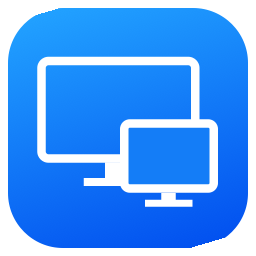

<div align="center">



# Utralview for Mac v2.3.3
### BasanCorp Enterprise Edition

**Native UltraViewer client & host for macOS: high-speed, secure remote desktop control with a single Universal installer for all Macs (Apple Silicon M1/M2/M3/M4 and Intel).**

[Tiếng Việt](README.md) · **English** · [PRD Specification](PRD.md) · [User Manual](HUONG_DAN_SU_DUNG.md)

### [Download Utralview for Mac v2.3.3 (GitHub Releases)](https://github.com/trithucnen-max/macviewer/releases/tag/v2.3.3)

Official Release v2.3.3 — Digitally signed by **BASAN CORPORATION**

[](https://github.com/trithucnen-max/macviewer/releases/tag/v2.3.3)
[](LICENSE)

-green)


</div>

---

## 🚀 Introduction

[UltraViewer](https://ultraviewer.net/en/) is a widely used remote desktop application on Windows. **Utralview for Mac v2.3.3**, developed by **BASAN CORPORATION**, is a pure native macOS solution that enables fast, low-latency remote desktop control and screen sharing with computers running UltraViewer (Windows) or Utralview (macOS).

Built 100% with **Swift 6 & SwiftUI** alongside embedded C libraries (`CZstd` v0.4–v0.7 and `CG722` WebRTC Audio Decoder), Utralview runs natively without Wine or any Windows `.exe`/`.dll` dependencies.

> [!NOTE]
> The single Universal DMG installer is digitally signed with `Developer ID Application: BASAN CORPORATION (JFT5TLZ3HK)`, equipped with Apple Hardened Runtime, Entitlements, and Apple Timestamping.

---

## 📦 Download macOS Universal Installer (v2.3.3)

A single **Universal DMG** installs cleanly on every Mac running macOS 14.0 Sonoma or newer (both Apple Silicon M1/M2/M3/M4 `arm64` and Intel `x86_64`):

| Platform / Device | Package Name | Download Link | Architecture & Specs |
| :--- | :--- | :---: | :--- |
| 🍏 **macOS Universal (All Macs)** | `Utralview-for-Mac-v2.3.3-Universal.dmg` | [Download (.dmg)](https://github.com/trithucnen-max/macviewer/releases/download/v2.3.3/Utralview-for-Mac-v2.3.3-Universal.dmg) | Single Universal binary for Apple Silicon (M1–M4) & Intel Macs |
| 🛡️ **Checksums** | `SHA256SUMS.txt` | [View Hashes](https://github.com/trithucnen-max/macviewer/releases/download/v2.3.3/SHA256SUMS.txt) | SHA-256 file verification hash |

### Official SHA-256 Checksum (`v2.3.3` — Apple Notarized & Stapled)
```text
e674e01b1cd1c533b3ad5ce830dd708adaf8cd15a7ceecd248f45fdda387489e  Utralview-for-Mac-v2.3.3-Universal.dmg
```

---

## 🛠️ Installation & Apple Gatekeeper Resolution

### 1. Standard Installation
1. Download **`Utralview-for-Mac-v2.3.3-Universal.dmg`**.
2. Double-click the downloaded `.dmg` file.
3. Drag **`Utralview for Mac.app`** into your **`/Applications`** folder.

### 2. Resolving Gatekeeper Prompts
Browsers attach a quarantine attribute to downloaded binaries. Choose any of these quick solutions:

- **Method 1: One-Click Helper Script (Included in DMG)**
  - Double-click **`Mo-Utralview-Lan-Dau.command`** inside the DMG disk. It clears quarantine flags and launches Utralview immediately.
- **Method 2: System Settings**
  - Go to **System Settings** > **Privacy & Security**.
  - Scroll down to **Security** and click **"Open Anyway"** under Utralview for Mac.
- **Method 3: Terminal Command**
  ```bash
  xattr -cr "/Applications/Utralview for Mac.app"
  ```

---

## 🌟 Key Features in v2.3.3

### 1. Pure Native macOS Universal Architecture
- **Single Universal Binary (`arm64` + `x86_64`)**: Native performance across all Apple Silicon (M1/M2/M3/M4) and Intel Macs on macOS 14.0 Sonoma and newer.
- **Instant Password Authentication**: Connects directly using the partner password without requiring manual approval popups on Windows (`controlMode: -1`).
- **Non-blocking Screen Capture**: Offloads RGB555 pixel packing from `@MainActor` for smooth UI responsiveness while hosting.

### 2. Native 2-Column Interface
- Clean macOS navigation with a dedicated sidebar for local hosting credentials and a main workspace for remote partner connections.
- Tri-color design system: Slate (`#0D1117`), Cobalt Blue (`#2563EB`), Emerald Green (`#10B981`).

### 3. High-Performance Remote Desktop
- AES-128 and 3DES standard UltraViewer cryptosuites.
- Peer-to-Peer LAN Direct connection for maximum local network frame rates.
- Retina 4K/5K resolution streaming and multi-monitor switching.
- Intelligent keyboard mapping (<kbd>⌘</kbd> to <kbd>Win</kbd>, <kbd>⌥</kbd> to <kbd>Alt</kbd>, <kbd>⌃</kbd> to <kbd>Ctrl</kbd>).
- Low-latency real-time audio playback using G.722 WebRTC decoder.
- Live chat, session recording/screenshots, and bidirectional clipboard synchronization.

### 4. Smart Clipboard Guard & Enterprise Security
- **Clipboard Guard**: Detects and blocks accidental clipboard sharing of sensitive credentials (private keys, JWT tokens, GitHub PATs, API keys).
- **Zero Telemetry**: No user tracking or behavioral analytics.
- **macOS Keychain**: Credential management integrated directly into Apple Keychain.

---

## 📜 License & Copyright

- Copyright © 2026 **BASAN CORPORATION**.
- Distributed under the [MIT License](LICENSE).
- UltraViewer is a trademark of its respective owner; mentioned strictly for interoperability documentation.
