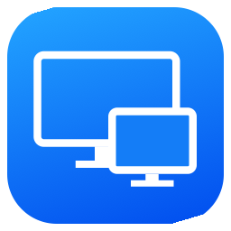

<div align="center">



# Utralview for Mac v2.3.3
### BasanCorp Enterprise Edition

**Dùng UltraViewer ngay trên máy Mac: điều khiển máy tính từ xa tốc độ cao, bảo mật tuyệt đối, hỗ trợ hoàn hảo mọi dòng máy Mac (Apple Silicon M1/M2/M3/M4 và Intel).**

**Tiếng Việt** · [English](README.en.md) · [Tài liệu PRD](PRD.md) · [Hướng dẫn sử dụng](HUONG_DAN_SU_DUNG.md)

### [Tải về Utralview for Mac v2.3.3 (GitHub Releases)](https://github.com/trithucnen-max/macviewer/releases/tag/v2.3.3)

Bản phát hành chính thức v2.3.3 — Ký số doanh nghiệp bởi **BASAN CORPORATION**

[](https://github.com/trithucnen-max/macviewer/releases/tag/v2.3.3)
[](LICENSE)

-green)


</div>

---

## 🚀 Giới thiệu Utralview for Mac

[UltraViewer](https://ultraviewer.net/vi/) là ứng dụng điều khiển máy tính phổ biến trên Windows. **Utralview for Mac v2.3.3** do **BASAN CORPORATION** phát triển là giải pháp native chuyên biệt cho hệ điều hành macOS, giúp kết nối hai chiều tới các máy tính chạy UltraViewer (Windows) hoặc Utralview (macOS) với hiệu năng vượt trội, độ trễ cực thấp và mức tiêu thụ tài nguyên tối thiểu.

Ứng dụng được viết hoàn toàn bằng **Swift 6 & SwiftUI** kết hợp các thư viện C chuẩn (`CZstd` v0.4–v0.7 và `CG722` WebRTC Audio Decoder), không chạy bất kỳ file `.exe`/`.dll` nào của Windows và không phụ thuộc Wine.

> [!NOTE]
> Bản cài đặt DMG Universal duy nhất đã được ký số bằng chứng chỉ `Developer ID Application: BASAN CORPORATION (JFT5TLZ3HK)` với Apple Hardened Runtime, Entitlements và Timestamping theo tiêu chuẩn kiểm định của Apple Gatekeeper.

---

## 📦 Tải bộ cài đặt macOS Universal (Duy nhất cho mọi dòng máy Mac)

Chỉ cần **1 bản cài đặt duy nhất** tương thích tự động với tất cả các dòng máy Mac (MacBook Air, MacBook Pro, Mac mini, iMac, Mac Studio, Mac Pro dùng cả chip **Apple Silicon M1/M2/M3/M4** và chip **Intel x86_64** chạy macOS 14.0 Sonoma trở lên):

| Nền tảng / Thiết bị | Tên tệp phát hành | Link tải trực tiếp | Mô tả & Kiến trúc |
| :--- | :--- | :---: | :--- |
| 🍏 **macOS Universal (Mọi máy Mac)** | `Utralview-for-Mac-v2.3.3-Universal.dmg` | [Tải về (.dmg)](https://github.com/trithucnen-max/macviewer/releases/download/v2.3.3/Utralview-for-Mac-v2.3.3-Universal.dmg) | Bản cài đặt hợp nhất duy nhất cho cả Apple Silicon (M1–M4 `arm64`) & Intel (`x86_64`) |
| 🛡️ **Bảng mã băm kiểm tra** | `SHA256SUMS.txt` | [Xem mã băm](https://github.com/trithucnen-max/macviewer/releases/download/v2.3.3/SHA256SUMS.txt) | Dùng để đối soát tính toàn vẹn và bảo mật của tập tin |

### Mã băm SHA-256 chính thức (`v2.3.3` — Apple Notarized & Stapled)
```text
e674e01b1cd1c533b3ad5ce830dd708adaf8cd15a7ceecd248f45fdda387489e  Utralview-for-Mac-v2.3.3-Universal.dmg
```

---

## 🛠️ Hướng dẫn cài đặt & Khắc phục cảnh báo mở trên macOS

### 1. Cài đặt thông thường
1. Tải tệp **`Utralview-for-Mac-v2.3.3-Universal.dmg`**.
2. Nhấp đúp vào tệp DMG đã tải về.
3. Kéo biểu tượng **`Utralview for Mac.app`** thả vào thư mục **`/Applications`**.

### 2. Khắc phục cảnh báo Apple Gatekeeper ("Apple không thể xác minh nhà phát triển")
Khi tải ứng dụng từ trình duyệt Web (Chrome, Safari), macOS sẽ tự động gắn cờ cách ly (Quarantine Flag). Bạn có thể mở nhanh bằng 1 trong các cách sau:

- **Cách 1: Sử dụng công cụ mở nhanh tích hợp trong DMG (Khuyên dùng)**
  - Bên trong file DMG có sẵn tệp **`Mo-Utralview-Lan-Dau.command`**.
  - Nhấp đúp chuột vào tệp này, hệ thống sẽ tự động gỡ bỏ cờ cách ly và khởi chạy ứng dụng ngay lập tức.
- **Cách 2: Cấp phép qua Cài đặt hệ thống (System Settings)**
  - Mở **Cài đặt hệ thống** (System Settings) > **Quyền riêng tư & Bảo mật** (Privacy & Security).
  - Cuộn xuống phần **Bảo mật** (Security), bạn sẽ thấy thông báo: *"Utralview for Mac đã bị chặn mở..."*.
  - Nhấp vào nút **"Vẫn mở"** (Open Anyway) và nhập mật khẩu máy Mac để xác nhận.
- **Cách 3: Mở bằng phím Control hoặc chuột phải**
  - Mở thư mục `/Applications`, nhấp chuột phải (hoặc giữ phím `Control` và bấm chuột) vào **`Utralview for Mac`**.
  - Chọn **Mở** (Open) > Bấm tiếp **Mở** (Open) trong hộp thoại xác nhận.
- **Cách 4: Sử dụng lệnh Terminal (Dành cho Pro/Admin)**
  ```bash
  xattr -cr "/Applications/Utralview for Mac.app"
  ```

---

## 🌟 Tính năng nổi bật trên bản v2.3.3

### 1. Kiến trúc Native Swift 6 tinh gọn & Hiệu năng cao
- **1 bản macOS Universal duy nhất (`arm64` + `x86_64`)**: Tương thích toàn diện với mọi máy Mac từ macOS Sonoma (14.0) trở lên.
- **Bỏ popup bắt xác thực trên Windows**: Kết nối điều khiển tức thì bằng mật khẩu đối tác (`controlMode: -1`).
- **Xử lý khung hình bất đồng bộ (Non-blocking Screen Capture)**: Chuyển đổi pixel `RGB555` tách biệt khỏi `@MainActor`, giữ giao diện luôn mượt mà 120Hz.
- **Ký số Developer ID chính thức**: Ký số bởi `BASAN CORPORATION (JFT5TLZ3HK)`.

### 2. Giao diện 2 cột Native & Hệ màu 3 sắc thái
- Bố cục 2 cột chuẩn mực gồm cột bên quản lý chia sẻ ID/Password của máy Mac và không gian làm việc kết nối đối tác.
- Hệ màu 3 sắc thái tối giản (Slate `#0D1117`, Cobalt Blue `#2563EB`, Emerald Green `#10B981`), loại bỏ hoàn toàn sự rối mắt, tối ưu tập trung cao độ.

### 3. Kết nối mượt mà & Điều khiển tức thì
- Kết nối thông qua mã hoá AES-128 và 3DES chuẩn giao thức UltraViewer.
- Tự động nhận diện kết nối ngang hàng mạng cục bộ (LAN Direct P2P) để đạt tốc độ hiển thị khung hình tối đa.
- Hỗ trợ màn hình Retina độ phân giải cao lên đến 4K/5K và chọn màn hình phụ (Multi-monitor).
- Ánh xạ bàn phím thông minh: Phím <kbd>⌘</kbd> trên Mac tự động chuyển đổi thành phím <kbd>Win</kbd>, <kbd>⌥</kbd> thành <kbd>Alt</kbd>, và <kbd>⌃</kbd> thành <kbd>Ctrl</kbd>.
- Tích hợp nghe âm thanh từ máy đối tác theo thời gian thực (Audio Streaming qua G.722 WebRTC decoder).
- Hỗ trợ Chat trực tiếp, chụp ảnh/quay video phiên điều khiển và đồng bộ Clipboard hai chiều.

### 4. Smart Clipboard Guard & Bảo mật doanh nghiệp
- **Clipboard Guard**: Ngăn chặn tuyệt đối việc vô tình chia sẻ các thông tin nhạy cảm (Private Keys, JWT tokens, GitHub PAT, API keys `sk-`, `ghp-`) qua clipboard.
- **Không Telemetry**: Ứng dụng không thu thập bất kỳ dữ liệu cá nhân hay lịch sử hoạt động nào của người dùng.
- **macOS Keychain**: Lưu trữ thông tin đăng nhập và mật khẩu an toàn trực tiếp trong Keychain của macOS.

---

## 📂 Cấu trúc dự án

```
MacViewer/
├── Sources/
│   ├── Utralview/              Giao diện & điều khiển macOS Native (Swift 6 / SwiftUI / AppKit)
│   └── UltraViewerProtocol/    Tầng giao thức kết nối, mã hoá AES/3DES, LAN P2P, Zstd & G.722
├── ThirdParty/
│   ├── zstd/                   Thư viện C Zstandard (hỗ trợ legacy format v0.4 - v0.7)
│   └── g722/                   Thư viện C WebRTC G.722 Audio Decoder
├── Tests/
│   ├── UtralviewTests/         Kiểm thử đơn vị tầng ứng dụng macOS
│   └── UltraViewerProtocolTests/ Kiểm thử đơn vị tầng giao thức, mã hoá & giải nén
├── PRD.md                      Tài liệu yêu cầu sản phẩm chi tiết v2.3.3
├── HUONG_DAN_SU_DUNG.md        Hướng dẫn sử dụng đầy đủ
├── DESIGN.md                   Đặc tả hệ thống thiết kế
└── scripts/                    Script tự động đóng gói macOS Universal và ký số BasanCorp
```

---

## 📜 Giấy phép & Bản quyền

- Bản quyền phần mềm © 2026 **BASAN CORPORATION** (BasanCorp).
- Phát hành mã nguồn mở theo [Giấy phép MIT](LICENSE).
- UltraViewer là nhãn hiệu thuộc sở hữu của đơn vị chủ quản UltraViewer, được nhắc đến nhằm mục đích chỉ rõ khả năng tương thích của giao thức.
